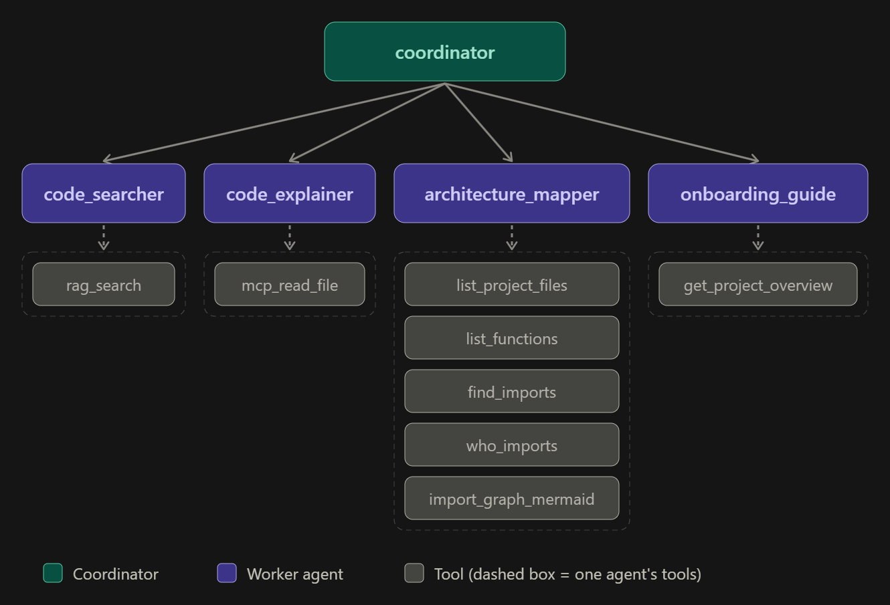

# Code_Helper_Multi_Agent_System

### What Code_Helper does?

Code Helper answers questions about a small Python project (Sample_Project/, a Naive RAG demo) using a team of five AI agents built with Google ADK: one coordinator(Boss) that only routes, and four workers(Code_Searcher, Code_Explainer, Architecture_Mapper, Onboarding_Guide). Each worker handles one kind of question: where code is, what a file does, how files connect, and where a newcomer should start. Search runs on a RAG pipeline written from scratch (no LangChain or LlamaIndex) that stores code chunks in Pinecone.

### Architecture of Code_Helper



### Table for Agents

| Agent | Job | Tools | Example question |
|---|---|---|---|
| `coordinator` | Sends each question to the right worker. Never answers itself. | none (routes only) | any question |
| `code_searcher` | Finds where something is implemented, using RAG search. | `rag_search` | Where is the search done? |
| `code_explainer` | Reads a whole file and explains it in simple text. | Filesystem MCP tools (`mcp_read_file`) | Explain vector_store.py |
| `architecture_mapper` | Lists files, functions and imports, and draws the import map, using plain Python. | `list_project_files`, `list_functions`, `find_imports`, `who_imports`, `import_graph_mermaid` | Which files import config.py? |
| `onboarding_guide` | Says what the project does, how to run it and where to start. | `get_project_overview` | I am new. Where do I start? |

### Table for Tools 

| Tool | Used by | Purpose | Uses AI? |
|---|---|---|---|
| `rag_search` | `code_searcher` | Embeds the question and returns the closest code chunks from Pinecone, with file, line numbers and function name | Embedding only |
| `list_project_files` | `architecture_mapper` | Lists the project's `.py` files with line counts | No |
| `list_functions` | `architecture_mapper` | Lists classes, methods and functions in one file | No |
| `find_imports` | `architecture_mapper` | Shows what one file imports | No |
| `who_imports` | `architecture_mapper` | Shows which files import a given module | No |
| `import_graph_mermaid` | `architecture_mapper` | Returns the file-to-file import map as Mermaid text | No |
| `get_project_overview` | `onboarding_guide` | Summarizes each file and the start of `main.py`, and explains where to begin | No |
| Filesystem MCP tools | `code_explainer` | Read whole files from the sample project (not counted in the 7 tools above) | No |

Six of the seven tools are plain Python. The Filesystem MCP server's own tools are not counted in the seven.

### RAG pipeline

1. Read: every top-level .py file in Sample_Project/.
2. Split: hybrid chunking (see below).
3. Embed: each chunk is sent to nvidia/nemotron-3-embed-1b on NVIDIA NIM through the openai client. Chunks are embedded as passage, questions as query. Vectors have 2048 dimensions.
4. Store: Pinecone serverless index code-helper (2048 dimensions, cosine), with file path, line range, chunk type, name and text as metadata.
5. Search: the question is embedded, then Pinecone returns the 5 closest chunks.

### Chunking: size and why

Method: hybrid, structure-aware chunking (built with Python's ast module).

- Each top-level function is one chunk, and each class is one chunk.
- Code between definitions (imports, constants, module docstring) becomes a module-level chunk. Module-level chunks under 60 tokens are skipped, because snippets like if __name__ == "__main__": main() carry almost no meaning and matched unrelated questions.
- Chunk size cap: 300 tokens (counted with tiktoken). A block above the cap is split by lines with a 3-line overlap, so a cut never separates a statement from its context.
- Methods inside a class stay in the class chunk. A class above 300 tokens is split by lines.

### Why I chose it: 

code has a clear structure that a plain fixed-size splitter ignores, so I combined two methods.

- Structure first. A question like "Where is the search done?" is normally answered by one whole function. Making each function and class one chunk keeps every result readable on its own, and the saved line range and function name point to an exact place. Fixed-size splitting would cut functions in half.
- Fixed-size splitting as a safety net. Chunks are capped at 300 tokens, because a very long block mixes several ideas. Longer blocks are split by lines with a 3-line overlap, so a cut never separates a statement from its context. Overlap is used only here.
- Module-level code kept, but filtered. Imports and constants stay as chunks, but those under 60 tokens are skipped because they carry almost no meaning.

On the sample project this gave 49 chunks averaging 205 tokens, with the largest at the 300-token cap.

### MCP server: Filesystem

Server: @modelcontextprotocol/server-filesystem, started with npx and connected through ADK's McpToolset. It is attached to code_explainer only.

Why: the Code Explainer must read whole files, and this ready-made server provides file-reading tools without writing a custom function. It can only read the folder it is given, so it is restricted to Sample_Project/ and cannot reach .env or the agent code.

### Sample Questions

- Question 1: Search goal define in config.py file

Answer : The goal of the code is to load, validate, and manage credentials and runtime parameters for NVIDIA NIM (Embeddings & LLM Generation) and Pinecone Vector Database. This is done to centralize configuration, prevent scattered calls to os.getenv() across multiple modules, and guarantee that if an API key is missing or the network is unavailable during a live lecture, the system can gracefully inform the student or fall back to a safe offline demonstration mode without crashing.

- Question 2: I am new user. How do I start this project?

Answer : ## Project Overview
This project implements a complete Naive RAG (Retrieval-Augmented Generation) pipeline. It loads knowledge documents, chunks them, embeds them via NVIDIA NIM, and stores them in Pinecone. When queried, it retrieves the most relevant chunks and generates grounded, factual answers.

Recommended Reading Order
1. config.py — Configuration, environment credentials, and data models.
2. indexer.py — Knowledge document loading, AST chunking, and embedding pipeline.
3. vector_store.py — Vector database management (Pinecone with local JSON fallback).
4. query_pipeline.py — Live query embedding, top-k retrieval, and answer synthesis.
5. main.py — End-to-end interactive CLI demonstration connecting all stages.

How to Run
```bash
python main.py

You can also run specific stages:

python main.py --index
python main.py --query "What is the coolant temperature for the fusion reactor?"
python main.py --compare
```
- Question 3: list functions of main.py.

Answer : The main.py file contains four functions:
print_banner(title: str)
print_scorecard(query: str, raw_answer: str, rag_answer: str, chunks: list[dict])
run_full_demo(config: RAGConfig)
main()

- Question 4: Explain main.py file

Answer : The main.py file is the entry point of the Naive RAG Live Demonstration & Stage Walkthrough project. It provides an end-to-end interactive CLI runner for the Day 4 Naive RAG lecture, tracing each stage against the 8-box RAG architecture diagram (Slide 13).

The goal of the code is to load, validate, and manage credentials and runtime parameters for NVIDIA NIM (Embeddings & LLM Generation) and Pinecone Vector Database. This is done to centralize configuration, prevent scattered calls to os.getenv() across multiple modules, and guarantee that if an API key is missing or the network is unavailable during a live lecture, the system can gracefully inform the student or fall back to a safe offline demonstration mode without crashing.

The main.py file contains several functions, including:

print_banner: prints a high-visibility terminal header box for classroom projectors
print_scorecard: prints an educational scorecard comparing the raw model response to the RAG response
run_full_demo: executes the entire 8-stage live classroom walkthrough
main: parses command-line arguments and runs the chosen demonstration routine
The main function uses the argparse library to parse command-line arguments and run the chosen demonstration routine. It supports several options, including:

--index: runs only the offline indexing pipeline (Stages 1-4)
--query: runs only the online query pipeline with a custom question (Stages 5-8)
--compare: runs the baseline vs. RAG comparison on the canonical question
--mock: forces offline simulation mode without making external API calls
The main function also defines a canonical test query and uses it to run the complete live demo walkthrough by default.


### Problem Occurs 

*Problem:* agents looped on tool calls and gave wrong or missing answers even though the tool worked

*Symptoms:* In the ADK Events trace, tools such as `who_imports`, `list_functions` and `get_project_overview` returned correct results, but the worker agent:
- called the same tool again and again, sometimes producing 50 to 100 events for a single question;
- sometimes ended with a false failure message ("I couldn't map the architecture", "The project overview failed"), although the tool had not raised an error and its output did not start with `TOOL_ERROR:`;
- sometimes called extra tools that the question did not need (for example, drawing the import graph for a simple "who imports config.py" question).

*Cause:* The tools were not at fault: I verified their output directly in the trace. The model (Llama 3.2 11B) was unreliable at the step after a tool returns. It did not treat the result as a finished answer, so it kept calling tools, and it fell back on failure wording. In a multi-agent setup, workers that are allowed to transfer control back to the coordinator or sideways to other workers can also bounce control between agents, which adds more events. This is the most likely explanation based on the traces.

*Fix.* I made four changes and retested:

1. **Instructions with a clear stop rule.** Each worker was told to call its tool exactly once and then write the answer from the result. Failure is defined only as tool output that starts with `TOOL_ERROR:`, and the canned failure sentences were removed.
2. **`temperature=0`.** Makes the model's behaviour after tool calls more consistent.
3. **Transfers disabled on the workers.** Workers can no longer hand control back to the coordinator or to each other, so they must finish and answer themselves

