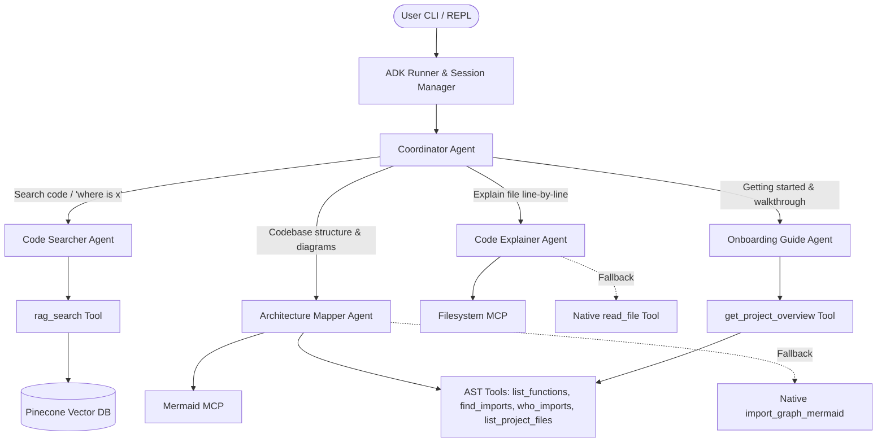

# Code Helper — Project Master Plan & Architecture Specification

## 1. Project Overview & Objective

**Code Helper** is an AI-powered multi-agent codebase exploration and developer onboarding system built using:
- **Google ADK (Agent Development Kit)** for hierarchical multi-agent orchestration
- **LiteLLM / NVIDIA NIM** (`meta/llama-3.2-11b-vision-instruct` for reasoning, `nvidia/nemotron-3-embed-1b` for 2048-dim embeddings)
- **Pinecone Vector Database** (Serverless, AWS `us-east-1`) for semantic code and documentation search
- **Model Context Protocol (MCP)** for filesystem access and Mermaid diagram rendering, with native Python fallbacks
- **Python AST** for static code analysis, function extraction, and dependency graph generation
- **Sample_Project/** as the primary target codebase (a Naive RAG implementation consisting of `config.py`, `indexer.py`, `vector_store.py`, `query_pipeline.py`, and `main.py`).

---

## 2. Multi-Agent System Architecture



### Agent Roles & Specifications

| Agent | Role | Tools Assigned | Fallback |
| :--- | :--- | :--- | :--- |
| **`coordinator`** | Root supervisor. Classifies questions and routes to the best worker agent. Never answers code queries directly. | Sub-agents: `code_searcher`, `code_explainer`, `architecture_mapper`, `onboarding_guide` | N/A |
| **`code_searcher`** | Locates where features, classes, or logic are implemented. Cites file names and exact line numbers. | `rag_search` | Directs user to run `/index` if Pinecone is unindexed |
| **`code_explainer`** | Reads full source files and explains their purpose, functions, and connections line-by-line. | Filesystem MCP (`@modelcontextprotocol/server-filesystem`) | Native `read_file` tool |
| **`architecture_mapper`** | Explains system structure, module dependencies, function lists, and generates dependency diagrams. | Mermaid MCP, `list_project_files`, `list_functions`, `find_imports`, `who_imports` | Native `import_graph_mermaid` tool |
| **`onboarding_guide`** | Guides new developers on where to start, what the project does, and in what order to read and run files. | `get_project_overview` | Built from project docstrings and `main.py` header |

---

## 3. Tool Specifications & Implementations

### Phase 1: AST Code Tools (`code_helper/tools/code_tools.py`) — [COMPLETED]
All tools are written using Python standard library (`ast`, `pathlib`), return plain strings, never raise exceptions, reject path traversal (`..`, `/`, `\\`), and have $\le 5$ line agent docstrings.

1. **`list_project_files() -> str`**:
   - Lists all top-level `.py` files in `PROJECT_DIR` with their exact line counts.
2. **`list_functions(file_name: str) -> str`**:
   - Lists all classes with their methods (indented) and top-level functions with line numbers and arguments.
3. **`find_imports(file_name: str) -> str`**:
   - Analyzes a file's imports, separating project-file imports from external imports, showing imported names.
4. **`who_imports(module_name: str) -> str`**:
   - Finds which project files import a given module (accepts `'config'` or `'config.py'`).
5. **`import_graph_mermaid() -> str`**:
   - Emits a Mermaid flowchart in a ` ```mermaid ` block showing project-file dependencies (`A --> B`).
6. **`get_project_overview() -> str`**:
   - Generates one-line summaries per file from docstrings, prints the first 40 lines of `main.py`, and gives a factual explanation of the project.

### Phase 2: Indexing Pipeline (`code_helper/index_codebase.py`) — [PENDING]
- **Target Files**:
  - Scans Python files (`*.py`) and documentation (`*.md`, `*.txt`).
  - Ignores `.venv`, `__pycache__`, `.git`, notebooks (`*.ipynb`), and data dumps (`*.json`).
- **Hybrid AST Chunking**:
  - Uses `ast` to split Python code cleanly at class and function boundaries.
  - Caps chunks at ~300 tokens.
  - Falls back to sliding-window line chunking with a 10-line overlap for functions that exceed 300 tokens or markdown/text files.
  - Metadata per chunk: `file_path` (relative to project root), `start_line`, `end_line`, `name`, `chunk_type` (`function`, `class`, `module`, `doc`), `text`.
- **Pinecone Vector Database Operations**:
  - Auto-creates the Pinecone index `code-helper` if missing (2048 dimensions, metric `cosine`, Serverless AWS `us-east-1`).
  - CLI flag `--clean`: drops existing vectors in the index before indexing.
  - Batching: generates embeddings using `nvidia/nemotron-3-embed-1b` with `input_type="passage"` and upserts in batches of 50-100 chunks.

### Phase 3: RAG Retrieval Tool (`code_helper/tools/rag.py`) — [PENDING]
- **`rag_search(query: str, top_k: int = 5, file_filter: str = "") -> str`**:
  - Generates query embedding via `nvidia/nemotron-3-embed-1b` with `input_type="query"`.
  - Queries Pinecone index with optional metadata filtering on `file_path`.
  - Formats results into structured markdown blocks containing:
    - Match index and relevance score
    - File path and line range (e.g. `Sample_Project/vector_store.py: Lines 28-59`)
    - Chunk type and name (e.g. `[function: calculate_cosine_similarity]`)
    - Exact code snippet.
  - If no relevant matches or index is empty, returns: `"I couldn't find anything useful in the codebase. You can run 'python run.py --index' to index the code."`

### Phase 4: MCP Integration & Native Fallbacks (`code_helper/tools/mcp_client.py`) — [PENDING]
- Installs and configures `mcp` library for Google ADK `McpToolset`.
- Transports:
  - Filesystem MCP: `npx -y @modelcontextprotocol/server-filesystem <PROJECT_DIR>`
  - Mermaid MCP: diagram generation tool
- **Defensive Fallback Adapter**:
  - Wraps MCP tool calls in try/except blocks.
  - If Node/npx is missing, timed out, or errors out, transparently routes to native Python tools (`read_file` and `import_graph_mermaid`) so agents never crash.

### Phase 5: Multi-Agent Coordination (`code_helper/agent.py`) — [PENDING]
- **Fix Model Reference**: Replace `model="model"` string with the initialized `LiteLlm` model instance `model=model`.
- **Clean Prompt Instructions**: Fix minor spelling typos (`fnds nothng`, `fle system`, `architeture`, `aks`) to improve LLM tool selection accuracy.
- **Tool Attachment**:
  - `code_searcher`: `tools=[rag_search]`
  - `code_explainer`: `tools=[mcp_read_file_or_fallback]`
  - `architecture_mapper`: `tools=[list_project_files, list_functions, find_imports, who_imports, import_graph_mermaid]`
  - `onboarding_guide`: `tools=[get_project_overview]`
  - `coordinator`: `sub_agents=[code_searcher, code_explainer, architecture_mapper, onboarding_guide]`

## 4. Implementation Status & Checklist

- [x] **Phase 1**: Implement and test 6 AST code tools in `code_helper/tools/code_tools.py`
- [ ] **Phase 2**: Implement hybrid AST chunking and Pinecone indexing in `code_helper/index_codebase.py`
- [ ] **Phase 3**: Implement precision RAG retrieval tool in `code_helper/tools/rag.py`
- [ ] **Phase 4**: Set up MCP toolset integration with native fallbacks
- [ ] **Phase 5**: Refactor, fix, and wire multi-agent definitions in `code_helper/agent.py`
- [ ] **Phase 6**: End-to-end verification across all 4 worker agents on `Sample_Project/`
